Non c'è un filo conduttore: ogni tanto decido che *quella cosa* va rifatta meglio, e parte una nuova quest. Questa è la mia schermata di salvataggio.

## 🎮 Scheda personaggio

| Stat | Valore |
|---|---|
| **Giocatore** | Gabriel, detto SickSartori |
| **Classe** | Tinkerer (sviluppatore, esploratore seriale) |
| **Specialità** | Port di giochi, estensioni di Windows, CAM, giochi satirici |
| **Armi** | C++, TypeScript, JavaScript, .NET |
| **Equipaggiamento** | Direct3D 11, XAudio2, XInput, resvg, three.js, Vite, Supabase, GitHub Actions |
| **Difetto** | Ogni progetto ne genera altri tre |

## 🗺️ Quest log

### 🏎️ mc3port: Midnight Club 3 su Windows nativo
`v0.3.0` · C++ · MIT · [Codice](https://github.com/SickSartori/mc3port) · [Release](https://github.com/SickSartori/mc3port/releases)

Port non ufficiale di *Midnight Club 3: DUB Edition Remix* (Xbox, PAL). Il codice x86 del gioco gira nativo sul PC, e mc3port rimpiazza la console intorno: kernel, GPU NV2A (su Direct3D 11), audio (su XAudio2) e controller (su XInput). Parte dalla **tua immagine disco**: nessun file di gioco incluso.

💎 **Loot:** vero 16:9, 60 fps, risoluzione interna fino a 4K, effetti opzionali (F10 per confrontarli) e un launcher in italiano e inglese.

Progetto di fan non ufficiale, non affiliato a Rockstar, Take-Two o Microsoft.

### 🖼️ svg-preview: miniature SVG in Esplora file
`v2.0.1` · C++ · LGPL-3.0 · [Codice](https://github.com/SickSartori/svg-preview) · [Release](https://github.com/SickSartori/svg-preview/releases)

Fork di *SVG Explorer Extension* di Tibold Kandrai, a cui va il merito dell'originale. Ho sostituito il motore QtSvg, che ignora `clipPath`, maschere e filtri, con **resvg**: gli SVG esportati da Illustrator, Affinity o Inkscape tornano a vedersi giusti. Una sola DLL di circa 3 MB, senza Qt da distribuire.

💎 **Loot:** `winget install SickSartori.SvgPreview`

### 🛠️ CarveCAM: CAM web per mini CNC
`v0.4.0` · .NET + three.js · MIT · [Codice](https://github.com/SickSartori/CarveCAM) · [Scarica](https://github.com/SickSartori/CarveCAM/releases/latest)

Dal modello 3D al G-code: svuotatura a terrazze, finitura in proiezione, piani di lavoro inclinati (3+2), controllo collisioni e simulazione del taglio con il grezzo che si consuma. Preset per GRBL (anche grblHAL e FluidNC), LinuxCNC, Mach3/Mach4 e Fanuc, con manuale e guida illustrata.

💎 **Loot:** un CAM leggero per hobbisti e piccole officine. È ancora versione 0.x: verifica sempre il G-code nel simulatore della tua macchina.

### 🤡 espo-clicker: The Ultimate Bug-Farming Simulator
`v3.2` · TypeScript · [▶︎ Gioca nel browser](https://espooclicker.altervista.org) · [Codice](https://github.com/SickSartori/espo-clicker)

Idle game satirico sulla vita da sviluppatore: clicchi la faccia di Espòòò, il manager perennemente sorpreso, e i bug vengono risolti. Poi tornano. 11 team, 89 upgrade, 29 skin, 45 achievement e 6 minigiochi arcade, in italiano e inglese, installabile come PWA.

💎 **Loot:** è il più vecchio dei miei repo pubblici: iniziato a novembre 2025.

### ❓ sm2port: ???
Quest sbloccata il 4 novembre 2026. Il repo è ancora vuoto: niente spoiler.

## 📊 Statistiche di gioco

Ogni stella è un giorno di lavoro, le linee uniscono le raffiche. Salvataggio automatico ogni giorno. Parte del lavoro vive in repo privati e compare solo come stelle.

**Velocità di sviluppo:** giorni tra un nuovo progetto pubblico e il successivo, 205, poi 108, poi 29, poi 9. Se la tendenza continua, il prossimo è già iniziato. *(Dati al 5 novembre 2026.)*

## 🏆 Achievement

🦈 **Pull Shark** · ⚡ **Quickdraw** · ❓ *il prossimo si sblocca da solo, di solito a mezzanotte.*

## 🎧 Multiplayer

Se hai un'idea strana, la party è aperta: scrivimi su [Discord](https://discord.com/users/381193306719125509).

Insert coin to continue.
