Ciao, sono Gabriel. Scrivo software e mi piace cominciare cose nuove: il port di un gioco, uno strumento per Windows. Non c'è un filo conduttore, c'è la curiosità di vedere se si può fare. Uso soprattutto C++, TypeScript, JavaScript e .NET.

## Cosa sto facendo

Questi sono i progetti pubblici, dal più recente.

###  [abyssport](https://github.com/SickSartori/abyssport) Uncharted: L'abisso d'oro su Windows

Il più nuovo, e il primo che non viene da una Xbox: è un gioco per PS Vita. Qui il codice del gioco non può girare così com'è, quindi viene ricompilato sul tuo PC a partire dalla tua copia, una volta sola, in una quindicina di minuti. È agli inizi: si gioca il prologo, più avanti non l'ho ancora provato, e se trovi un problema [segnalamelo](https://github.com/SickSartori/abyssport/issues).

###  [sm2port](https://github.com/SickSartori/sm2port) Spider-Man 2 su Windows

È partito come fork di mc3port, perché è lo stesso tipo di lavoro. Il gioco gira dalla tua immagine disco, in 16:9, fino a 60 fps, con mouse e tastiera. È la versione 0.1.0, uscita il 5 novembre: l'ho provata per minuti, non per ore, quindi aspettati dei problemi, e se ne trovi uno [segnalameli](https://github.com/SickSartori/sm2port/issues).

###  [mc3port](https://github.com/SickSartori/mc3port) Midnight Club 3 su Windows

Il codice del gioco gira nativo sul PC, e io rifaccio quello che c'era intorno: kernel della console, grafica, audio, controller. Ora siamo alla v0.3.0, con vero 16:9, 60 fps, risoluzione interna fino a 4K, effetti opzionali e un launcher in italiano e inglese.

###  [svg-preview](https://github.com/SickSartori/svg-preview) le miniature SVG di Esplora file, fatte bene

È un fork dell'estensione di Tibold Kandrai, a cui va il merito dell'originale. Il motore che usava ignorava `clipPath`, maschere e filtri, quindi molti SVG da Illustrator, Affinity o Inkscape si vedevano storti: l'ho sostituito con resvg. Si installa con `winget install SickSartori.SvgPreview`.

mc3port, sm2port e abyssport sono progetti di fan, non ufficiali e senza alcun file di gioco: serve la tua copia originale. Non sono affiliati a Rockstar, Take-Two, Marvel, Activision, Microsoft o Sony.

## Quanto lavoro c'è dietro

Ogni stella è un giorno in cui ho lavorato, e le linee uniscono i periodi di fila. Parte del lavoro sta in repo privati e compare solo come stelle. Il disegno si aggiorna da solo ogni giorno.

Una cosa che ho notato guardando le date: i giorni tra un nuovo progetto pubblico e il successivo sono stati 205, poi 108, poi 29, poi 9. Non è un piano, succede. *(Dati al 5 novembre 2026.)*

## Scrivimi

Se hai un'idea strana, o un bug da segnalare, apri una issue nel repo giusto oppure scrivimi su [Discord](https://discord.com/users/381193306719125509).
