# Ciao, sono Gabriel

Sviluppatore con la fissa dei side project. Non c'è un filo conduttore: ogni tanto decido che *quella cosa* va rifatta meglio, e parte un nuovo esperimento.

<picture>
  <source media="(prefers-color-scheme: dark)" srcset="assets/toolpath-dark.svg">
  
</picture>

Il grafico dei contributi, ripassato da una fresa CNC. Si aggiorna da solo ogni giorno. Parte del lavoro vive in repo privati e compare solo come quadratini.

## Il laboratorio

| Esperimento | Cos'è | Stack |
|---|---|---|
| [**mc3port**](https://github.com/SickSartori/mc3port) | Port nativo per Windows di Midnight Club 3: DUB Edition Remix. 16:9, fino a 60 fps. Parte dalla tua immagine disco: nessun file di gioco incluso. | C++ |
| [**svg-preview**](https://github.com/SickSartori/svg-preview) | Miniature SVG in Esplora file, con resvg: clipPath, maschere e filtri finalmente giusti. | C++ |
| [**CarveCAM**](https://github.com/SickSartori/CarveCAM) | CAM web per mini CNC: svuotatura a terrazze, finitura in proiezione, G-code per GRBL, LinuxCNC, Mach3/Mach4 e Fanuc. | JavaScript |
| [**espo-clicker**](https://github.com/SickSartori/espo-clicker) | Idle game satirico sulla vita da sviluppatore: clicca la faccia del manager, coltiva bug. PWA in italiano e inglese. | TypeScript |

Se hai un'idea strana, scrivimi su [Discord](https://discord.com/users/381193306719125509).
